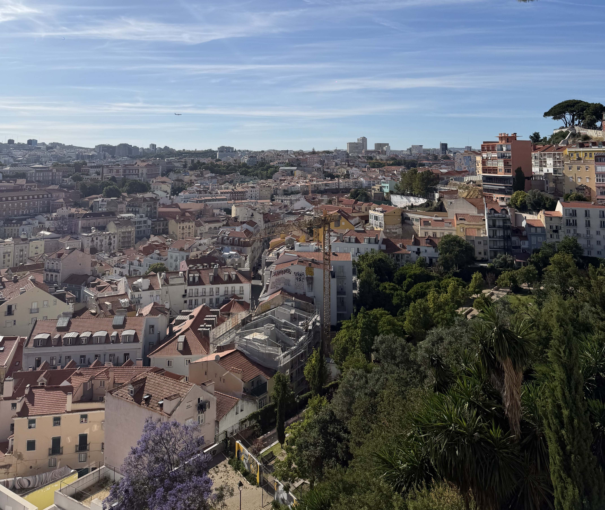

<!DOCTYPE html>
<html lang="en">

<head>
  <title>Loryana's Portfolio</title>
  <link rel="stylesheet" href="style.css">
  <meta charset="utf-8">
</head> 

<body>
  

    <header>
  <h1>Evolving Forms</h1>
</header>

<nav>
  <ul>
    <li><a href="website.html">Home</a></li>
    <li><a href="about.html">About</a></li>
    <li><a href="projects.html">Projects</a></li>
    <li><a href="architecture.html">Architecture</a></li>
  </ul>
</nav>
<main>
  <aside>
    <h2>Welcome!</h2>
    

      Architecture has been reimagined in so many different shapes and forms. Architecture doesn't follow a specific outline or purpose. Evolving Forms is about exploring interests, creative work, and influential pieces of architecture.  
    

    <section>
      <h2>Architecture Fact of the Day</h2>
      

    </section>
  </aside>

    

    

      
    

    <section class="intro-text">
      <h2>Exploring Architecture</h2>
      

        Add your introduction or information about your architectural interests here.
      

    </section>

</main>

</body>

<footer>
  

    <h2>Let's Connect!</h2>
    

      Have a question, project idea, or opportunity?
      I'd love to hear from you.
    

    <a href="mailto:loryanaclarke@gmail.com" class="contact-button">
      Contact Me
    </a>
  

  

    
© 2026 Loryana's Portfolio | Designed by Loryana Clarke

  

</footer>

</html>
